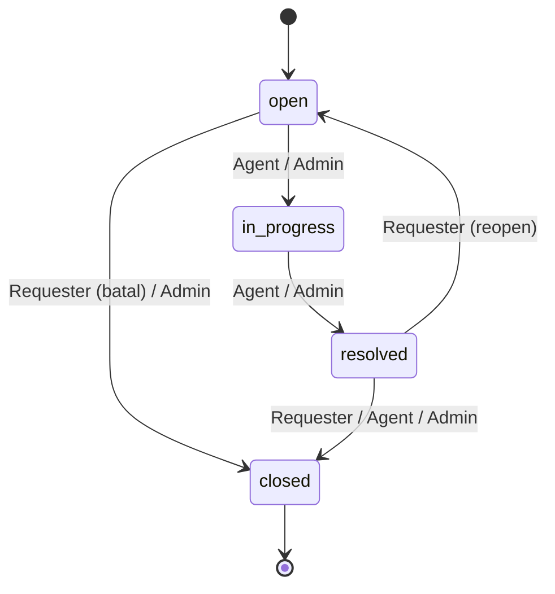
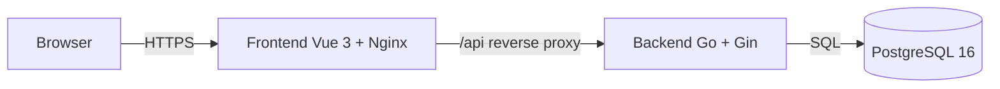
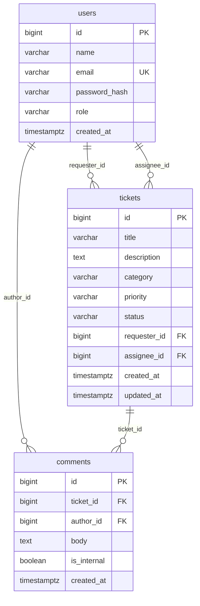

# PRD-00 — Ringkasan Produk & Kontrak Bersama

| Item | Keterangan |
|---|---|
| Produk | Helpdesk Internal (Technical Test Fullstack Shift Engineer) |
| Versi | 1.0 |
| Tanggal | 8 November 2026 |
| Status | Draft untuk implementasi |
| Dokumen terkait | [PRD-01-Backend.md](./PRD-01-Backend.md), [PRD-02-Frontend.md](./PRD-02-Frontend.md) |
| Sumber | `ZainulArifin_Fullstack_ShiftEngineer_TechnicalTest.txt` |

Dokumen ini adalah **kontrak bersama** antara Backend dan Frontend. Semua keputusan yang
berpotensi menimbulkan ketidakcocokan (peran, transisi status, format error, bentuk response,
dan model data) didefinisikan di sini dan **wajib dipatuhi** oleh kedua PRD turunan.

---

## 1. Latar belakang

Perusahaan masih menangani permintaan bantuan karyawan melalui email dan spreadsheet. Akibatnya
tiket mudah hilang, status tidak jelas, tidak ada jejak audit, dan beban agen sulit diukur.

Produk yang dibangun adalah aplikasi helpdesk internal sederhana dengan tiga peran
(Requester, Agent, Admin), REST API Go, antarmuka Vue 3, dan database relasional. Fokus penilaian
adalah **kebenaran aturan bisnis** (transisi status dan pembatasan akses), **kualitas struktur kode**,
**pengujian yang bermakna**, dan **kemudahan menjalankan aplikasi**.

## 2. Tujuan dan metrik keberhasilan

### Tujuan produk
1. Karyawan dapat membuat tiket dan memantau perkembangannya tanpa email.
2. Agen dapat mengambil, memprioritaskan, dan menyelesaikan tiket dari satu tempat.
3. Admin dapat mengelola akun dan peran.
4. Setiap perubahan status tervalidasi oleh backend sehingga data tetap konsisten.

### Metrik keberhasilan (Definition of Success)
| Metrik | Target |
|---|---|
| Aturan transisi status | 100% kasus pada tabel transisi diuji dan ditolak/diizinkan dengan benar |
| Kebocoran akses | 0 kasus requester dapat membaca tiket atau catatan internal milik orang lain |
| Test bermakna | Minimal 5 test backend lulus; minimal 5 test frontend lulus |
| Menjalankan aplikasi | `docker compose up` berhasil tanpa langkah manual tambahan |
| Dokumentasi | README + OpenAPI + catatan arsitektur tersedia dan akurat |
| Responsivitas | Semua halaman utama dapat dipakai pada lebar 375 px dan 1440 px |

## 3. Ruang lingkup

### 3.1 In scope (wajib)
- Autentikasi register/login dengan password ter-hash dan JWT.
- Otorisasi berbasis peran dan kepemilikan sumber daya.
- CRUD tiket (create, read, update status/prioritas/assignee).
- Daftar tiket dengan pagination, filter, pencarian, dan pengurutan.
- Komentar tiket termasuk catatan internal.
- Validasi transisi status sesuai tabel.
- Manajemen pengguna dan peran oleh Admin.
- Migrasi database idempotent dan seed minimal satu akun per peran.
- Minimal 5 unit/integration test bermakna.
- Konfigurasi via environment variable.
- Dockerfile + `docker-compose.yml` untuk backend, frontend, dan database.
- Halaman FE: login, register, daftar tiket, buat tiket, detail tiket, kelola pengguna.
- Dokumentasi: README, OpenAPI/Swagger atau koleksi Postman, catatan arsitektur.

### 3.2 Out of scope (tidak wajib, hanya bonus bila waktu cukup)
- Lampiran file pada tiket.
- Notifikasi real-time (WebSocket/SSE).
- Aturan SLA dan penanda terlambat.
- Halaman statistik admin.
- Pipeline CI.
- Refresh token, lupa password, verifikasi email.
- Multi-tenant, departemen, dan kategori yang dikelola lewat UI.
- Hard delete tiket.

### 3.3 Non-goals
- Aplikasi tidak ditujukan untuk produksi publik; ini artefak take-home.
- Tidak membangun integrasi email, Slack, atau sistem HR.

## 4. Persona dan peran

| Peran | Deskripsi | Kebutuhan utama |
|---|---|---|
| Requester | Karyawan yang membutuhkan bantuan | Membuat tiket, memantau, berkomentar, menutup/membuka kembali tiketnya |
| Agent | Staf dukungan yang menangani tiket | Melihat semua tiket, mengambil tiket, mengubah status/prioritas, menulis catatan internal |
| Admin | Pengelola sistem | Semua hak Agent + mengelola pengguna dan peran |

### 4.1 Aturan identitas
- Register publik **selalu** menghasilkan peran `requester`. Peran tidak boleh dikirim dari klien.
- Peran hanya dapat diubah oleh Admin melalui `PATCH /api/users/{id}/role`.
- Admin tidak boleh mengubah perannya sendiri (mencegah lockout).
- Sistem minimal memiliki satu Admin; demosi Admin terakhir ditolak.

## 5. Matriks hak akses

| Aksi | Requester | Agent | Admin |
|---|---|---|---|
| Register & login | Ya | Ya | Ya |
| Melihat profil sendiri (`/api/me`) | Ya | Ya | Ya |
| Membuat tiket | Ya | Ya | Ya |
| Melihat daftar tiket | Hanya miliknya | Semua | Semua |
| Melihat detail tiket | Hanya miliknya | Semua | Semua |
| Mengubah status | Sesuai tabel transisi, hanya tiket sendiri | Sesuai tabel transisi, semua tiket | Sesuai tabel transisi, semua tiket |
| Mengubah prioritas | Tidak | Ya | Ya |
| Mengubah assignee | Tidak | Terbatas (klaim diri / lepas diri) | Semua agent/admin |
| Menambah komentar publik | Hanya tiket sendiri | Semua | Semua |
| Menambah catatan internal | Tidak | Ya | Ya |
| Melihat catatan internal | Tidak | Ya | Ya |
| Melihat daftar pengguna | Tidak | Tidak | Ya |
| Mengubah peran pengguna | Tidak | Tidak | Ya |

Catatan keamanan: untuk requester, daftar tiket **selalu** dipaksa memfilter `requester_id = user.id`
di backend, apa pun query yang dikirim. Parameter `requester_id` dari requester diabaikan.

## 6. Siklus hidup tiket

### 6.1 Status
`open` → `in_progress` → `resolved` → `closed`, dengan jalur kembali `resolved` → `open`.

### 6.2 Tabel transisi resmi

| Dari | Ke | Oleh | Aturan tambahan |
|---|---|---|---|
| `open` | `in_progress` | Agent, Admin | Jika assignee kosong dan aktor Agent, assignee otomatis diisi aktor |
| `in_progress` | `resolved` | Agent, Admin | — |
| `resolved` | `closed` | Requester, Agent, Admin | Requester hanya boleh pada tiket miliknya |
| `resolved` | `open` | Requester | Hanya tiket miliknya (reopen) |
| `open` | `closed` | Requester, Admin | Requester hanya tiket miliknya (pembatalan) |

**Semua perpindahan lain ditolak** dengan HTTP `409 Conflict` dan kode error
`INVALID_TRANSITION`, disertai pesan yang menyebut status asal, status tujuan, dan peran aktor.
Contoh pesan: `"Transisi dari 'open' ke 'resolved' tidak diizinkan untuk peran 'agent'."`

### 6.3 Diagram status



### 6.4 Invarian
1. Tiket baru selalu berstatus `open` dan `assignee_id = null`.
2. Status tidak boleh bernilai di luar empat nilai resmi.
3. `closed` bersifat final pada versi ini (tidak ada transisi keluar).
4. Perubahan status dan perubahan assignee/prioritas dalam satu PATCH divalidasi sebagai satu kesatuan;
   jika salah satu field tidak valid, seluruh request ditolak (atomik).
5. Requester tidak dapat mengubah `priority` maupun `assignee_id`.
6. Riwayat perubahan status tidak wajib disimpan sebagai tabel terpisah pada versi ini; perubahan
   terlihat melalui `updated_at` dan komentar. (Audit log merupakan bonus.)

## 7. Arsitektur sistem



- Frontend di-serve oleh Nginx. Nginx mem-proxy `/api` ke service backend sehingga browser hanya
  berkomunikasi dengan satu origin (menghindari CORS di lingkungan Docker).
- Backend bersifat stateless; satu-satunya state persisten ada di PostgreSQL.
- Autentikasi menggunakan Bearer JWT pada header `Authorization`.

## 8. Kontrak API ringkas

Base path: `/api`. Semua response `application/json` kecuali disebutkan lain.

| Method | Path | Fungsi | Akses | Sukses |
|---|---|---|---|---|
| POST | `/api/auth/register` | Daftar akun requester | Publik | `201` |
| POST | `/api/auth/login` | Login, mengembalikan JWT | Publik | `200` |
| GET | `/api/me` | Profil pengguna saat ini | Login | `200` |
| GET | `/api/tickets` | Daftar tiket (filter, pagination) | Login, dibatasi peran | `200` |
| POST | `/api/tickets` | Buat tiket | Login | `201` |
| GET | `/api/tickets/{id}` | Detail tiket + komentar | Pemilik, Agent, Admin | `200` |
| PATCH | `/api/tickets/{id}` | Ubah status/prioritas/assignee | Sesuai matriks & transisi | `200` |
| POST | `/api/tickets/{id}/comments` | Tambah komentar/catatan internal | Pemilik, Agent, Admin | `201` |
| GET | `/api/users` | Daftar pengguna | Admin | `200` |
| PATCH | `/api/users/{id}/role` | Ubah peran | Admin | `200` |

Endpoint bonus (opsional): `GET /api/health`, `GET /api/stats`, `POST /api/tickets/{id}/attachments`.

### 8.1 Query parameter daftar tiket

| Parameter | Tipe | Default | Berlaku | Keterangan |
|---|---|---|---|---|
| `page` | int ≥ 1 | `1` | Semua | Halaman |
| `per_page` | int 1–100 | `20` | Semua | Ukuran halaman |
| `status` | enum | — | Semua | `open`, `in_progress`, `resolved`, `closed` |
| `priority` | enum | — | Semua | `low`, `medium`, `high`, `urgent` |
| `assignee_id` | int | — | Agent, Admin | Filter assignee |
| `unassigned` | bool | — | Agent, Admin | `true` = hanya tiket tanpa assignee |
| `search` | string | — | Semua | Pencarian judul, case-insensitive |
| `sort` | enum | `created_at` | Semua | `created_at`, `updated_at`, `priority`, `status` |
| `order` | enum | `desc` | Semua | `asc`, `desc` |

Pengurutan `priority` menggunakan urutan logis `urgent > high > medium > low`, bukan alfabetis.

## 9. Model data konseptual



### 9.1 Enum nilai

| Field | Nilai |
|---|---|
| `users.role` | `requester`, `agent`, `admin` |
| `tickets.status` | `open`, `in_progress`, `resolved`, `closed` |
| `tickets.priority` | `low`, `medium`, `high`, `urgent` |
| `tickets.category` | `hardware`, `software`, `network`, `access`, `other` |

Kategori dibuat enum agar validasi dan UI konsisten. Penambahan kategori baru dilakukan lewat
migrasi (bukan input bebas).

## 10. Konvensi API

### 10.1 Format response sukses
Objek tunggal:
```json
{ "data": { "id": 1, "title": "Laptop tidak menyala" } }
```

Daftar:
```json
{
  "data": [ { "id": 1 } ],
  "meta": { "page": 1, "per_page": 20, "total": 57, "total_pages": 3 }
}
```

### 10.2 Format response error
```json
{
  "error": {
    "code": "INVALID_TRANSITION",
    "message": "Transisi dari 'open' ke 'resolved' tidak diizinkan untuk peran 'agent'.",
    "details": { "from": "open", "to": "resolved" }
  }
}
```
- `details` opsional; untuk validasi form berisi map `field -> pesan`.
- Pesan error berbahasa Indonesia dan aman ditampilkan ke pengguna.
- Stack trace dan detail internal **tidak** boleh dikirim ke klien.

### 10.3 Kode HTTP dan kode error

| HTTP | Kode error | Kapan |
|---|---|---|
| `400` | `VALIDATION_ERROR` | Input tidak valid (field wajib, format, enum) |
| `401` | `UNAUTHENTICATED` | Token tidak ada, tidak valid, atau kedaluwarsa |
| `401` | `INVALID_CREDENTIALS` | Email/password salah saat login |
| `403` | `FORBIDDEN` | Peran tidak diizinkan atau bukan pemilik tiket |
| `403` | `INTERNAL_NOTE_FORBIDDEN` | Requester mencoba membuat catatan internal |
| `404` | `NOT_FOUND` | Resource tidak ada |
| `413` | `PAYLOAD_TOO_LARGE` | Body request melebihi batas 1 MB |
| `409` | `DUPLICATE_EMAIL` | Email sudah terdaftar |
| `409` | `INVALID_TRANSITION` | Transisi status di luar tabel |
| `409` | `SELF_ROLE_CHANGE` | Admin mencoba mengubah perannya sendiri |
| `409` | `LAST_ADMIN` | Demosi Admin terakhir |
| `500` | `INTERNAL_ERROR` | Kesalahan tak terduga |

### 10.4 Konvensi lain
- ID berupa integer (`BIGSERIAL`).
- Waktu memakai ISO 8601 UTC, contoh `2026-11-08T10:15:30Z`.
- Field `password_hash` tidak pernah muncul di response.
- Request body maksimum 1 MB.
- `Content-Type: application/json` wajib untuk POST/PATCH.
- Header `X-Request-ID` diterima/dikembalikan untuk penelusuran log (opsional).

## 11. Non-functional requirements

| Kategori | Requirement |
|---|---|
| Keamanan | Password bcrypt cost ≥ 12; JWT HS256 dengan secret dari env; tidak ada kredensial di source; validasi kepemilikan di layer service; pesan login gagal tidak membocorkan apakah email terdaftar |
| Performa | Response daftar tiket < 500 ms pada 10.000 tiket di lingkungan lokal; index pada kolom filter/sort |
| Reliabilitas | Migrasi idempotent; seed idempotent; healthcheck DB dan backend |
| Observability | Log JSON terstruktur, request ID, level log via env |
| Aksesibilitas | Label form, fokus terlihat, kontras WCAG AA, navigasi keyboard |
| Responsivitas | Berfungsi pada 375 px, 768 px, 1024 px, 1440 px |
| Kompatibilitas | Chrome/Firefox/Safari versi terbaru; Node 20+ untuk build FE |
| Maintainability | Pemisahan layer, tidak ada SQL di handler, tidak ada logika bisnis di komponen presentasional |

## 12. Asumsi

1. Satu tiket hanya dapat ditangani satu assignee.
2. Agent boleh mengambil tiket yang belum di-assign ke siapa pun; Agent tidak boleh mengambil alih
   tiket milik agent lain tanpa bantuan Admin (klaim hanya untuk diri sendiri).
3. Requester boleh membatalkan tiket hanya saat status `open`.
4. Komentar diizinkan pada semua status, termasuk `closed`; tiket `closed` tetap dapat dibaca.
5. Kategori menggunakan enum tetap.
6. Tidak ada hard delete; penghapusan data tidak termasuk kebutuhan.
7. JWT disimpan di `localStorage` (trade-off XSS vs. kesederhanaan) dan dihapus saat logout/401.
8. Seed password dibaca dari environment variable; nilai default **hanya untuk demo lokal** dan
   wajib diganti di lingkungan nyata.
9. Register tidak memerlukan verifikasi email.
10. Semua waktu disimpan UTC dan ditampilkan pada zona waktu browser.

## 13. Pertanyaan terbuka (untuk kontak rekrutmen)

| # | Pertanyaan | Asumsi sementara |
|---|---|---|
| 1 | Apakah Agent boleh assign ke agent lain? | Tidak; hanya Admin |
| 2 | Apakah tiket `closed` boleh dibuka kembali? | Tidak |
| 3 | Apakah komentar wajib ditutup saat tiket `closed`? | Tidak |
| 4 | Apakah perlu audit log perubahan status? | Tidak wajib, bonus |
| 5 | Apakah kategori bebas atau enum? | Enum |

## 14. Definition of Done

- [ ] Semua endpoint wajib pada §8 tersedia dan sesuai kontrak.
- [ ] Semua aturan transisi §6.2 diuji dan diterapkan backend.
- [ ] Requester tidak dapat membaca tiket/catatan internal orang lain (diuji).
- [ ] FE memiliki 6 halaman wajib dengan guard, loading, empty, dan error state.
- [ ] `docker compose up --build` menjalankan DB, backend, dan frontend.
- [ ] Migrasi + seed berjalan otomatis dan idempotent.
- [ ] Minimal 5 test backend dan 5 test frontend lulus.
- [ ] README memuat cara jalan, akun seed, daftar endpoint, dan cara test.
- [ ] OpenAPI atau koleksi Postman tersedia.
- [ ] Catatan arsitektur maksimal 1 halaman tersedia.
- [ ] Riwayat commit wajar (bukan satu commit besar).

## 15. Traceability requirement → dokumen

| Requirement test | Dokumen |
|---|---|
| Auth JWT, hash password, middleware peran | PRD-01 §6.1–6.3 |
| CRUD tiket & field | PRD-01 §6.4, §8.3–8.5 |
| Pagination/filter/search/sort | PRD-01 §6.5, §8.4 |
| Komentar & catatan internal | PRD-01 §6.6, §8.6 |
| Validasi transisi & HTTP code | PRD-00 §6, PRD-01 §6.7 |
| Pembatasan akses requester | PRD-00 §5, PRD-01 §6.3 |
| Migrasi & seed | PRD-01 §9 |
| Minimal 5 test | PRD-01 §12, PRD-02 §13 |
| Env config | PRD-01 §10 |
| Docker | PRD-01 §13, PRD-02 §14 |
| 6 halaman FE | PRD-02 §7 |
| Guard & state management | PRD-02 §5–6 |
| Loading/empty/error & responsif | PRD-02 §9–10 |

## 16. Struktur repository usulan (monorepo)

```
helpdesk/
├── backend/
│   ├── cmd/server/main.go
│   ├── internal/{config,domain,auth,repository,service,http,middleware}
│   ├── migrations/
│   ├── seed/
│   ├── tests/
│   ├── Dockerfile
│   ├── go.mod
│   └── .env.example
├── frontend/
│   ├── src/{assets,components,composables,layouts,router,stores,views,lib}
│   ├── public/
│   ├── Dockerfile
│   ├── nginx.conf
│   ├── vite.config.*
│   └── .env.example
├── docs/
│   ├── PRD-00-Umum.md
│   ├── PRD-01-Backend.md
│   ├── PRD-02-Frontend.md
│   ├── openapi.yaml
│   └── ARCHITECTURE.md
├── docker-compose.yml
├── .gitignore
└── README.md
```

## 17. Milestone implementasi

| Milestone | Cakupan | Kriteria selesai |
|---|---|---|
| M1 — Fondasi | Repo, docker compose, DB, migrasi, seed, healthcheck | `docker compose up` menyalakan DB + backend kosong |
| M2 — Auth & RBAC | register/login/me, middleware, users | Test auth & 403 lulus |
| M3 — Tiket inti | CRUD tiket, list, transisi, komentar | Test transisi & akses lulus |
| M4 — FE inti | login/register, list, create, detail | Alur utama dapat dilakukan di browser |
| M5 — FE admin & polish | kelola pengguna, responsive, state, a11y | Semua halaman lolos checklist |
| M6 — Dokumentasi | README, OpenAPI, catatan arsitektur, video | Reviewer dapat menjalankan tanpa bantuan |
